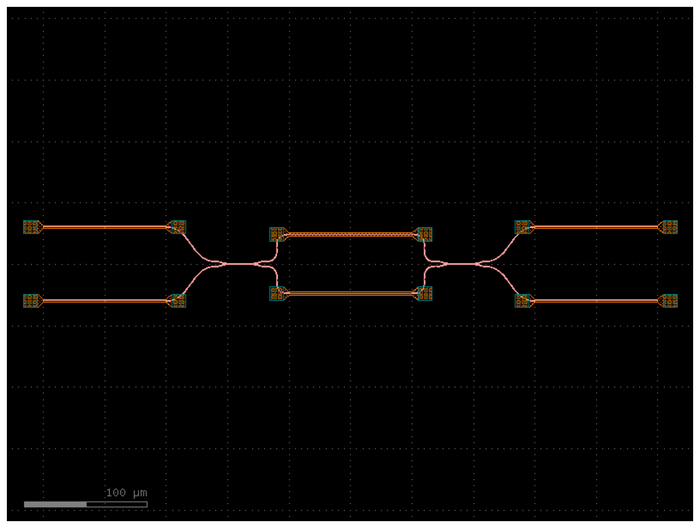

# Debatt-AI Open Photonic Lab

An open, reproducible laboratory for designing photonic AI accelerators: from
simulation of single components, through Mach–Zehnder interferometer (MZI)
meshes, to chip layouts that can be sent to a multi-project wafer (MPW)
fabrication run.

> **Status:** early stage. The lab currently contains a series of
> reproducible Meep FDTD experiments on generic dielectric waveguides. No
> foundry-calibrated component or chip layout exists yet. See the
> [roadmap](#roadmap).

## Interactive demonstrations

- **Open Photonic Lab:** [Explore the photonic chip design laboratory](https://debatt-ai-open-photonic-lab.mr-marcus-sweden.chatgpt.site/)
- **MZI learning simulation:** [Explore optical interference and AI learning](https://optiskt-ai-larande.mr-marcus-sweden.chatgpt.site/)

## Why

Optical computing can perform matrix–vector multiplication, the core
operation of neural networks, with light instead of electrons. Going from an
idea to a fabricated photonic chip is still hard and mostly happens behind
closed doors. This lab aims to make every step open, documented and
reproducible so that anyone can learn from it and build on it.

## Principles

1. **Reproducible:** every experiment runs in GitHub Actions against an exact,
   locked conda environment
   ([`opa-fdtd-linux-64.lock.txt`](simulations/meep/opa-fdtd-linux-64.lock.txt)).
2. **Honest:** every result states what it does *not* show. Illustrative
   models are never presented as foundry-validated predictions.
3. **Incremental:** experiments are numbered (`OPA-FDTD-NNN`), small, and
   build on each other. Old experiments are kept unchanged as a record.

## Roadmap

| Phase | Goal | Status |
|-------|------|--------|
| 1 | FDTD fundamentals: reproducible Meep pipeline, convergence and normalization practice | **Done** (001–009) |
| 2 | Guided-mode metrics in 3D (eigenmode source and decomposition) | **Started** (010–011) |
| 3 | Real material platforms (e.g. Si/SiO₂ 220 nm, SiN, LNOI) and spectral response | Planned |
| 4 | GDSFactory components in an open PDK: waveguide, bend, directional coupler, MMI, phase shifter, single 2×2 MZI | **Started** (LAYOUT-001, generic PDK) |
| 5 | MZI mesh (2×2 → 4×4) as an optical matrix multiplier, with a link to the MZI learning simulation | **Started** (MZI-001–003) |
| 6 | Design-rule-checked GDS ready for an MPW run | Planned |
| 7 | Measurement plan and published measurement data | Planned |

Fabricating photonic chips requires a foundry. The realistic open path is to
share designs made in open PDKs and submit them to MPW runs, where many
designs share one wafer.

## Experiments

All experiments live in [`simulations/meep/`](simulations/meep/) and each has
its own workflow in [`.github/workflows/`](.github/workflows/). Workflow
artifacts expire after 90 days, so every result report is also kept in
[`results/`](results/), with a `provenance.json` that names the CI run and
commit it came from. [`results/README.md`](results/README.md) lists the key
numbers for every experiment.

| ID | What it establishes |
|----|---------------------|
| 001 | Meep runs reproducibly in CI with a locked environment (free-space smoke test) |
| 002 | Normalized 2D straight-waveguide / air-gap scattering with convergence check |
| 003 | Exploratory 2D 90° bend-radius comparison (aperture flux) |
| 004 | 2D guided-mode power audit of bends using eigenmode decomposition |
| 005 | Memory and runtime benchmark for bounded 3D simulations |
| 006 | Guarded 40×40×4 µm 3D capacity profile |
| 007 | First 3D dielectric waveguide bend comparison (aperture flux) |
| 008 | Temporal convergence of the 3D bend simulations |
| 009 | Grid-resolution sensitivity of the 3D bend simulations |
| 010 | 3D modal decomposition (odd-Z band 1) of bend ports, still with a finite-size Ez source |
| 011 | 3D **guided-mode** bend transmission: launched TE-like eigenmode, decomposed at both ports, validated by a straight reference |

### OPA-FDTD-011 results

Fundamental TE-like mode, index-1.8 core (0.8 × 0.4) in air, vacuum
wavelength 1.25 (Meep units), 90° bend:

| Case | Guided transmission (res 12 → 16) | Loss at res 16 | Aperture-flux ratio at res 16 |
|------|-----------------------------------|----------------|-------------------------------|
| Straight reference | 0.9996 → 0.9998 | 0.001 dB | 1.000 |
| Bend, radius 1.0 | 0.333 → 0.315 | 5.0 dB | 0.472 |
| Bend, radius 2.0 | 0.762 → 0.743 | 1.3 dB | 0.819 |

What this shows:

- The straight waveguide transmits 99.98 % in the guided mode, which
  validates the measurement method.
- Within this experiment, aperture flux **overestimates** guided
  transmission (0.472 vs 0.315 at radius 1.0) because it also counts radiated
  light that passes through the output aperture. The 007–010 numbers are not
  directly comparable: they use an Ez current, which excites the TM-like
  (odd-Z) polarization, and normalize to the straight input aperture flux.
- Guided reflection is about 0.00001 for both bends, measured after
  subtracting the straight-reference fields. Without that subtraction, leakage
  of the incident field into the discretized backward mode reads about 10–20×
  higher, comparable to the straight waveguide's own leakage floor.
- The low index contrast (1.8 vs 1.0) makes tight bends very lossy. Real
  platforms such as silicon (index ≈ 3.48) allow much tighter bends.
- Changing the resolution from 12 to 16 changes transmission by less than 0.02,
  but two resolutions do not prove convergence.
- Not yet checked: sensitivity to port-monitor size and PML thickness (mode
  confinement), more resolutions, and an independent mode-solver comparison of
  the effective index (n_eff ≈ 1.359). Until then these numbers are
  preliminary.

The full CI report is
[`results/opa-fdtd-011/result.json`](results/opa-fdtd-011/result.json); a local
run with the same locked environment agreed to within 2e-9.

## Circuit experiments

FDTD shows how light behaves inside one component. Circuit experiments treat
each component as a small complex matrix and ask what a whole circuit computes.
They live in [`simulations/circuit/`](simulations/circuit/), use only numpy from
the same locked environment, and run in seconds.

| ID | What it establishes |
|----|---------------------|
| MZI-001 | An ideal 2×2 MZI plus an output phase screen is a programmable 2×2 unitary matrix multiplier |
| MZI-002 | How coupler errors, arm loss, phase noise and phase resolution limit that multiplier, and what calibration can recover |
| MZI-003 | A Clements mesh realizes any N×N unitary; two meshes plus attenuators run a 4×4 neural-network layer |

### OPA-MZI-001 results

A 2×2 MZI is two 50:50 couplers with an internal phase shifter θ between them
and an external phase shifter φ on one input. θ sets how power is split
(top-port output power = sin²(θ/2)) and φ sets the relative phase. With two
more phase shifters on the outputs, the circuit can realize **any** 2×2 unitary
matrix, which is the building block of the meshes used in optical AI
accelerators.

| Check | Max error |
|-------|-----------|
| Transfer matrix equals the closed form | 4e-16 |
| Unitarity (lossless) | 7e-16 |
| Power splitting follows sin²(θ/2) | 7e-16 |
| 1000 random unitaries + bar/cross/Hadamard programmed exactly | 2e-15 |
| Targets 1e-12 to 1e-4 rad from the bar and cross states | 7e-16 |
| Programmed circuit multiplies input vectors correctly | 2e-15 (relative) |
| Real 30° rotation weight applied to real inputs | 5e-16 |

All errors are at floating-point rounding level. As a sensitivity check, the same
settings on hardware with 48:52 instead of 50:50 couplers give errors of 0.04,
which shows why fabrication tolerance (OPA-MZI-002) matters.

Not included: loss, fabrication errors, wavelength dependence, and detection.
Photodetectors measure power |y|², not the complex field.

### OPA-MZI-002 results

Two ways of setting the phases are compared on imperfect hardware: **naive**
(settings computed for ideal hardware) and **calibrated** (settings computed for
the measured hardware). Error is the relative matrix error after removing a
common gain; effective bits = log₂(1/error).

**Coupler splitting errors** (300 random targets):

| Coupler split | Naive mean error | Calibrated mean error | Exactly reachable targets |
|---------------|------------------|-----------------------|---------------------------|
| 50.5 / 50.5 % | 0.0064 | 4e-16 | 100 % |
| 51 / 51 % | 0.013 | 4e-16 | 100 % |
| 52 / 52 % | 0.026 | 4e-16 | 100 % (theory 99.8 %) |
| 55 / 55 % | 0.064 | 4e-16 | 100 % (theory 99.0 %) |
| 55 / 45 % | 0.070 | 3e-4 | 99.3 % (theory 99.0 %) |

Without calibration, the error is roughly 1.3 × the coupler error. With
calibration, every target inside the analytic reachable range is realized
exactly. Coupler errors shrink that range: equal errors in both couplers prevent
full extinction (for example a 20 dB limit at 55 %), and opposite errors prevent
full transmission.

**Loss in one internal arm** cannot be calibrated away, because the circuit is no
longer unitary: 0.1 dB → 0.6 % error, 1 dB → 5.7 %, 3 dB → 17 %. The same
loss in both arms costs only power (shape error 4e-16). Phase shifters should
therefore have matched dummy loss in the other arm.

**Phase precision:**

| Phase noise σ | Mean error | Effective bits | | DAC bits | Mean error | Effective bits |
|---------------|------------|----------------|-|----------|------------|----------------|
| 0.001 rad | 0.0013 | 9.7 | | 6 | 0.038 | 4.8 |
| 0.01 rad | 0.013 | 6.4 | | 8 | 0.0092 | 6.8 |
| 0.1 rad | 0.13 | 3.0 | | 10 | 0.0024 | 8.8 |

The error is about 1.28 × σ, and each extra DAC bit gives about one more
effective bit.

**Combined fabrication scenario** (200 chips; coupler split σ = 1 %, 0.2 dB
phase-shifter loss, 10-bit DAC, 0.005 rad phase noise): median error 0.018
(5.8 effective bits) without calibration and 0.013 (6.2 bits) with calibration.
The remaining error is dominated by the unbalanced 0.2 dB arm loss, which is
the main design lesson.

Assumes exact knowledge of the hardware for calibration, a single wavelength,
and no thermal crosstalk or drift.

### OPA-MZI-003 results

A **Clements mesh** arranges N(N−1)/2 MZIs in N columns, so every path crosses
the same number of MZIs. It can realize any N×N unitary matrix. A general weight
matrix W is realized through its singular value decomposition W = U·Σ·V†: one
mesh for V†, a column of attenuators for Σ, and one mesh for U.

| Check | Result |
|-------|--------|
| Random unitaries, N = 2, 3, 4, 8, 16 | reconstructed to ≤ 3e-15; 1, 3, 6, 28, 120 MZIs; N columns |
| 200 random real 4×4 weight matrices as mesh–attenuators–mesh | ≤ 1e-14 relative error |

**Error grows with mesh size** (mean error):

| N | MZIs | Coupler spread 1 %, naive | Same, calibrated | Phase noise 0.01 rad |
|---|------|---------------------------|------------------|----------------------|
| 2 | 1 | 0.013 | 2e-16 | 0.013 |
| 4 | 6 | 0.023 | 2e-5 | 0.019 |
| 8 | 28 | 0.035 | 5e-16 | 0.028 |

Errors grow roughly as √N, because light crosses N MZIs and their errors add
randomly. Global calibration, which re-optimizes all phases of the whole mesh
for the measured hardware, removes coupler errors almost completely. Phase noise
cannot be calibrated away.

**Toy neural-network layer.** A linear 4-class classifier, trained digitally on
synthetic 4-feature data, runs on the photonic layer:

| | Test accuracy | Weight error | Effective bits |
|---|---|---|---|
| Digital | 86.8 % | – | – |
| Ideal photonic layer | 86.8 % (identical predictions) | 1e-14 | – |
| 20 imperfect chips, naive | 86.8 % (range 86.6–86.9 %) | 5.4 % | 4.2 |
| 20 imperfect chips, calibrated | 86.8 % (range 86.5–86.9 %) | 4.1 % | 4.6 |
| Ideal optics, power-only readout | 63.1 % | – | – |

The imperfect chips use the MZI-002 assumptions (1 % coupler spread, 0.2 dB
phase-shifter loss, 10-bit DAC, 0.005 rad noise) in all 12 MZIs. On this easy
task, 4–5 % weight error does not change the accuracy. Harder tasks and deeper
networks will be more sensitive. The power-only result shows that the phase of
the output matters: either coherent detection or an encoding that keeps outputs
positive is needed.

## Layout

Chip layouts live in [`layout/`](layout/) and use
[gdsfactory](https://github.com/gdsfactory/gdsfactory) in their own locked
Python 3.13 environment ([`layout/requirements-lock.txt`](layout/requirements-lock.txt)).

### OPA-LAYOUT-001: programmable 2×2 MZI



The same circuit as OPA-MZI-001, drawn as a GDS file
([`programmable_mzi_2x2.gds`](results/opa-layout-001/programmable_mzi_2x2.gds),
532 × 71 µm). From left to right: phase shifter φ, then two 2×2 directional
couplers with heater θ between them, then output phase shifters a and b. Every
powered heater has an identical unpowered heater on the other waveguide, so both
paths see the same heater loss, which was the lesson from OPA-MZI-002.

| Check | Result |
|-------|--------|
| 4 optical ports, inputs west and outputs east, 0.5 µm wide; top port = waveguide 0 of the circuit model | pass |
| 2 directional couplers and 6 identical heaters | pass |
| Internal arms equal length (170.548 µm each) | pass, difference 0 |
| Input and output paths equal length on both waveguides | pass |
| Fan-out S-bends do not cross; heater footprints do not overlap | pass |
| GDS byte-for-byte reproducible, also from a fresh lockfile install | pass |

The crossing check caught a real bug during development: the input S-bends
were mirrored, so the top input ended up at the bottom and the two input
waveguides crossed.

**Limits:** this uses gdsfactory's *generic* example PDK, not a foundry process.
Layers, design rules and heaters are placeholders, and the coupler length is
not yet tuned to 50:50. No foundry DRC has been run, and there are no bond pads
or fiber couplers yet.

## Running locally

```bash
# Requires micromamba (or conda/mamba) on linux-64
micromamba create -n opa-fdtd --file simulations/meep/opa-fdtd-linux-64.lock.txt
micromamba activate opa-fdtd
python simulations/meep/bend_3d_launched_mode_v011.py   # writes results/opa-fdtd-011/result.json
python simulations/circuit/mzi_2x2_v001.py               # writes results/opa-mzi-001/result.json, < 1 s
python simulations/circuit/mzi_imperfect_v002.py         # writes results/opa-mzi-002/result.json, ~1 min
python simulations/circuit/mesh_clements_v003.py         # writes results/opa-mzi-003/result.json, ~15 s
```

Layouts need Python 3.13 and their own environment:

```bash
python3.13 -m venv .venv-layout && . .venv-layout/bin/activate
pip install -r layout/requirements-lock.txt
python layout/mzi_2x2_layout_v001.py                     # writes the GDS, PNG and report to results/opa-layout-001/
```

New experiments should import shared geometry and measurement helpers from
[`simulations/meep/opa_common.py`](simulations/meep/opa_common.py).

## Contributing

Contributions are welcome. Add a new numbered experiment (`OPA-FDTD-NNN`)
with its own workflow, state its limitations in the result report, add a
row to the experiment table above, and archive the report in
[`results/`](results/README.md#adding-a-result).

## License

[MIT](LICENSE)
