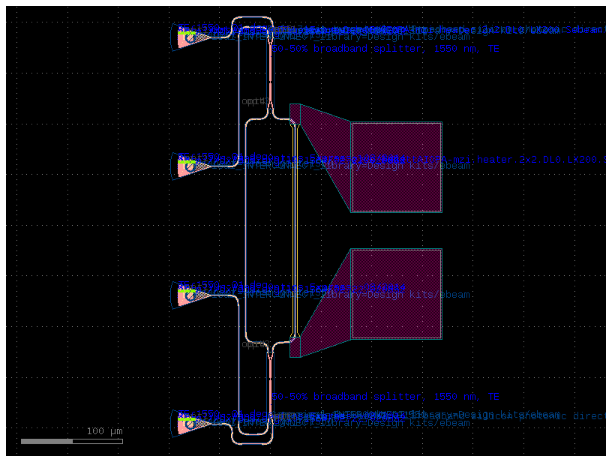
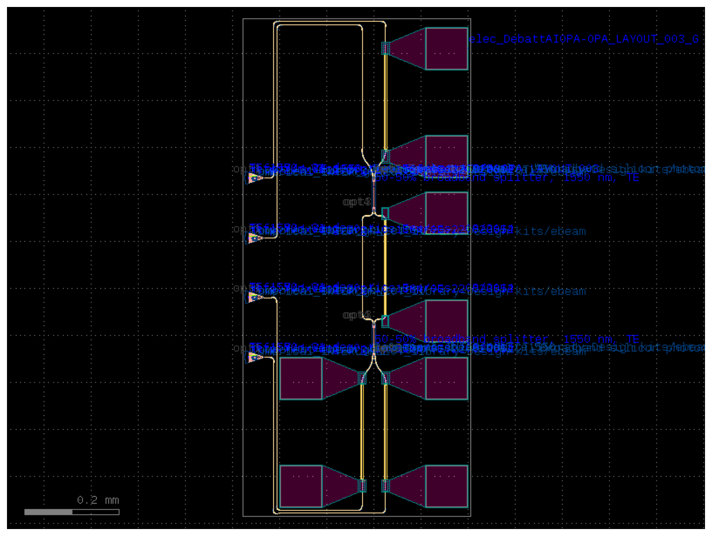
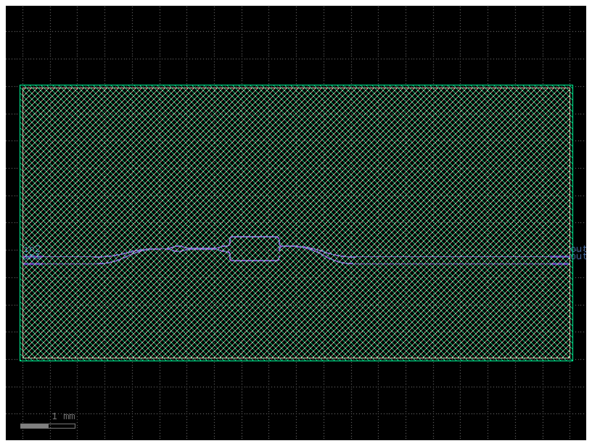
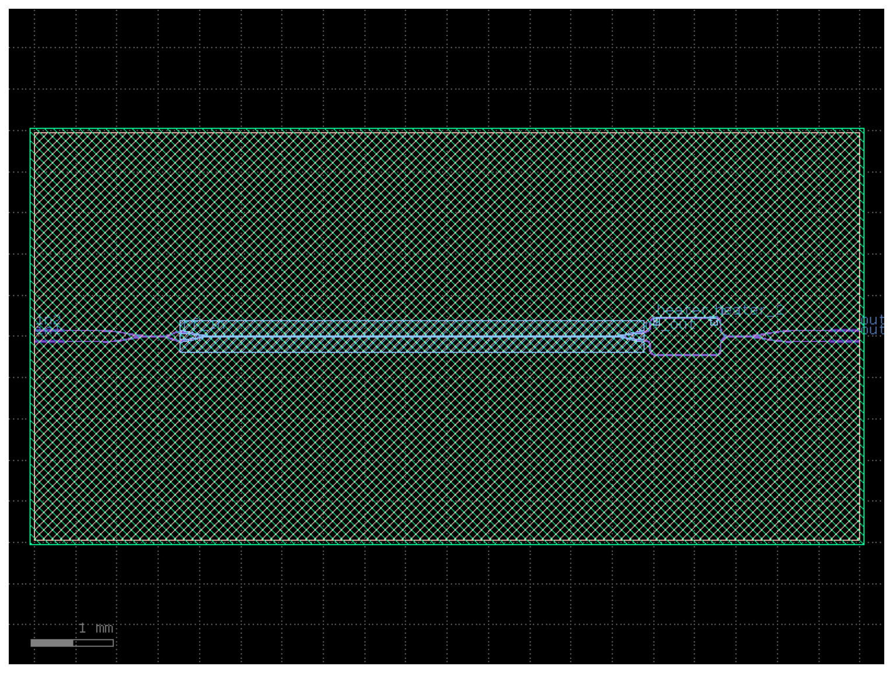

# Debatt-AI Open Photonic Lab

An open, reproducible laboratory for designing photonic AI accelerators: from
simulation of single components, through Mach–Zehnder interferometer (MZI)
meshes, to chip layouts that can be sent to a multi-project wafer (MPW)
fabrication run.

> **Status:** early stage. The lab currently contains a series of
> reproducible Meep FDTD experiments on generic dielectric waveguides. No
> foundry-calibrated component or chip layout exists yet. See the
> [roadmap](#roadmap).

## Interactive demonstrations

- **Open Photonic Lab:** [Explore the photonic chip design laboratory](https://debatt-ai-open-photonic-lab.mr-marcus-sweden.chatgpt.site/)
- **MZI learning simulation:** [Explore optical interference and AI learning](https://optiskt-ai-larande.mr-marcus-sweden.chatgpt.site/)

## Why

Optical computing can perform matrix–vector multiplication, the core
operation of neural networks, with light instead of electrons. Going from an
idea to a fabricated photonic chip is still hard and mostly happens behind
closed doors. This lab aims to make every step open, documented and
reproducible so that anyone can learn from it and build on it.

## Principles

1. **Reproducible:** every experiment runs in GitHub Actions against an exact,
   locked conda environment
   ([`opa-fdtd-linux-64.lock.txt`](simulations/meep/opa-fdtd-linux-64.lock.txt)).
2. **Honest:** every result states what it does *not* show. Illustrative
   models are never presented as foundry-validated predictions.
3. **Incremental:** experiments are numbered (`OPA-FDTD-NNN`), small, and
   build on each other. Old experiments are kept unchanged as a record.

## Roadmap

| Phase | Goal | Status |
|-------|------|--------|
| 1 | FDTD fundamentals: reproducible Meep pipeline, convergence and normalization practice | **Done** (001–009) |
| 2 | Guided-mode metrics in 3D (eigenmode source and decomposition) | **Started** (010–011) |
| 3 | Real material platforms (e.g. Si/SiO₂ 220 nm, SiN, LNOI) and spectral response | **Started** (COUPLER-001, Si 220 nm; EO-001–002, X-cut TFLN) |
| 4 | GDSFactory components in an open PDK: waveguide, bend, directional coupler, MMI, phase shifter, single 2×2 MZI | **Started** (LAYOUT-001 generic PDK; LAYOUT-002–003 SiEPIC EBeam; LAYOUT-004–005 Luxtelligence lnoi400) |
| 5 | MZI mesh (2×2 → 4×4) as an optical matrix multiplier, with a link to the MZI learning simulation | **Started** (MZI-001–003) |
| 6 | Design-rule-checked GDS ready for an MPW run (includes a 32 px/µm FDTD convergence run of the coupler, see OPA-COUPLER-002) | **Started** (LAYOUT-002 and LAYOUT-003 pass the official SiEPIC EBeam DRC) |
| 7 | Measurement plan and published measurement data | Planned |

Fabricating photonic chips requires a foundry. The realistic open path is to
share designs made in open PDKs and submit them to MPW runs, where many
designs share one wafer.

## Experiments

Every experiment is a script in [`simulations/`](simulations/) with an entry in
[`simulations/experiments.json`](simulations/experiments.json). The entry gives
its result folder, its time limit and the files it depends on. One workflow,
[`experiments.yml`](.github/workflows/experiments.yml), runs the experiments
that a pull request affects in the locked environment: an experiment runs when
its script or one of its dependencies changes, and every experiment runs when
the locked environment changes. CI fails if an experiment script has no entry,
or imports or reads a repository file that its entry does not list. Any
experiment can also be run by hand from the Actions tab (*Experiments* →
*Run workflow*, with ids such as `opa-fdtd-005` or `all`). Each run also produces an `all-experiment-results.zip` download in its Actions summary, containing all available experiment artifacts in separate directories and a bundle manifest. Failed runs can contain partial results; consult the manifest and job status. Individual downloads remain available. Workflow
artifacts expire after 90 days, so every result report is also kept in
[`results/`](results/), with a `provenance.json` that names the CI run and
commit it came from. [`results/README.md`](results/README.md) lists the key
numbers for every experiment.

| ID | What it establishes |
|----|---------------------|
| 001 | Meep runs reproducibly in CI with a locked environment (free-space smoke test) |
| 002 | Normalized 2D straight-waveguide / air-gap scattering with convergence check |
| 003 | Exploratory 2D 90° bend-radius comparison (aperture flux) |
| 004 | 2D guided-mode power audit of bends using eigenmode decomposition |
| 005 | Memory and runtime benchmark for bounded 3D simulations |
| 006 | Guarded 40×40×4 µm 3D capacity profile |
| 007 | First 3D dielectric waveguide bend comparison (aperture flux) |
| 008 | Temporal convergence of the 3D bend simulations |
| 009 | Grid-resolution sensitivity of the 3D bend simulations |
| 010 | 3D modal decomposition (odd-Z band 1) of bend ports, still with a finite-size Ez source |
| 011 | 3D **guided-mode** bend transmission: launched TE-like eigenmode, decomposed at both ports, validated by a straight reference |

### OPA-FDTD-011 results

Fundamental TE-like mode, index-1.8 core (0.8 × 0.4) in air, vacuum
wavelength 1.25 (Meep units), 90° bend:

| Case | Guided transmission (res 12 → 16) | Loss at res 16 | Aperture-flux ratio at res 16 |
|------|-----------------------------------|----------------|-------------------------------|
| Straight reference | 0.9996 → 0.9998 | 0.001 dB | 1.000 |
| Bend, radius 1.0 | 0.333 → 0.315 | 5.0 dB | 0.472 |
| Bend, radius 2.0 | 0.762 → 0.743 | 1.3 dB | 0.819 |

What this shows:

- The straight waveguide transmits 99.98 % in the guided mode, which
  validates the measurement method.
- Within this experiment, aperture flux **overestimates** guided
  transmission (0.472 vs 0.315 at radius 1.0) because it also counts radiated
  light that passes through the output aperture. The 007–010 numbers are not
  directly comparable: they use an Ez current, which excites the TM-like
  (odd-Z) polarization, and normalize to the straight input aperture flux.
- Guided reflection is about 0.00001 for both bends, measured after
  subtracting the straight-reference fields. Without that subtraction, leakage
  of the incident field into the discretized backward mode reads about 10–20×
  higher, comparable to the straight waveguide's own leakage floor.
- The low index contrast (1.8 vs 1.0) makes tight bends very lossy. Real
  platforms such as silicon (index ≈ 3.48) allow much tighter bends.
- Changing the resolution from 12 to 16 changes transmission by less than 0.02,
  but two resolutions do not prove convergence.
- Not yet checked: sensitivity to port-monitor size and PML thickness (mode
  confinement), more resolutions, and an independent mode-solver comparison of
  the effective index (n_eff ≈ 1.359). Until then these numbers are
  preliminary.

The full CI report is
[`results/opa-fdtd-011/result.json`](results/opa-fdtd-011/result.json); a local
run with the same locked environment agreed to within 2e-9.

## Circuit experiments

FDTD shows how light behaves inside one component. Circuit experiments treat
each component as a small complex matrix and ask what a whole circuit computes.
They live in [`simulations/circuit/`](simulations/circuit/), use only numpy from
the same locked environment, and run in seconds.

| ID | What it establishes |
|----|---------------------|
| MZI-001 | An ideal 2×2 MZI plus an output phase screen is a programmable 2×2 unitary matrix multiplier |
| MZI-002 | How coupler errors, arm loss, phase noise and phase resolution limit that multiplier, and what calibration can recover |
| MZI-003 | A Clements mesh realizes any N×N unitary; two meshes plus attenuators run a 4×4 neural-network layer |

### OPA-MZI-001 results

A 2×2 MZI is two 50:50 couplers with an internal phase shifter θ between them
and an external phase shifter φ on one input. θ sets how power is split
(top-port output power = sin²(θ/2)) and φ sets the relative phase. With two
more phase shifters on the outputs, the circuit can realize **any** 2×2 unitary
matrix, which is the building block of the meshes used in optical AI
accelerators.

| Check | Max error |
|-------|-----------|
| Transfer matrix equals the closed form | 4e-16 |
| Unitarity (lossless) | 7e-16 |
| Power splitting follows sin²(θ/2) | 7e-16 |
| 1000 random unitaries + bar/cross/Hadamard programmed exactly | 2e-15 |
| Targets 1e-12 to 1e-4 rad from the bar and cross states | 7e-16 |
| Programmed circuit multiplies input vectors correctly | 2e-15 (relative) |
| Real 30° rotation weight applied to real inputs | 5e-16 |

All errors are at floating-point rounding level. As a sensitivity check, the same
settings on hardware with 48:52 instead of 50:50 couplers give errors of 0.04,
which shows why fabrication tolerance (OPA-MZI-002) matters.

Not included: loss, fabrication errors, wavelength dependence, and detection.
Photodetectors measure power |y|², not the complex field.

### OPA-MZI-002 results

Two ways of setting the phases are compared on imperfect hardware: **naive**
(settings computed for ideal hardware) and **calibrated** (settings computed for
the measured hardware). Error is the relative matrix error after removing a
common gain; effective bits = log₂(1/error).

**Coupler splitting errors** (300 random targets):

| Coupler split | Naive mean error | Calibrated mean error | Exactly reachable targets |
|---------------|------------------|-----------------------|---------------------------|
| 50.5 / 50.5 % | 0.0064 | 4e-16 | 100 % |
| 51 / 51 % | 0.013 | 4e-16 | 100 % |
| 52 / 52 % | 0.026 | 4e-16 | 100 % (theory 99.8 %) |
| 55 / 55 % | 0.064 | 4e-16 | 100 % (theory 99.0 %) |
| 55 / 45 % | 0.070 | 3e-4 | 99.3 % (theory 99.0 %) |

Without calibration, the error is roughly 1.3 × the coupler error. With
calibration, every target inside the analytic reachable range is realized
exactly. Coupler errors shrink that range: equal errors in both couplers prevent
full extinction (for example a 20 dB limit at 55 %), and opposite errors prevent
full transmission.

**Loss in one internal arm** cannot be calibrated away, because the circuit is no
longer unitary: 0.1 dB → 0.6 % error, 1 dB → 5.7 %, 3 dB → 17 %. The same
loss in both arms costs only power (shape error 4e-16). Phase shifters should
therefore have matched dummy loss in the other arm.

**Phase precision:**

| Phase noise σ | Mean error | Effective bits | | DAC bits | Mean error | Effective bits |
|---------------|------------|----------------|-|----------|------------|----------------|
| 0.001 rad | 0.0013 | 9.7 | | 6 | 0.038 | 4.8 |
| 0.01 rad | 0.013 | 6.4 | | 8 | 0.0092 | 6.8 |
| 0.1 rad | 0.13 | 3.0 | | 10 | 0.0024 | 8.8 |

The error is about 1.28 × σ, and each extra DAC bit gives about one more
effective bit.

**Combined fabrication scenario** (200 chips; coupler split σ = 1 %, 0.2 dB
phase-shifter loss, 10-bit DAC, 0.005 rad phase noise): median error 0.018
(5.8 effective bits) without calibration and 0.013 (6.2 bits) with calibration.
The remaining error is dominated by the unbalanced 0.2 dB arm loss, which is
the main design lesson.

Assumes exact knowledge of the hardware for calibration, a single wavelength,
and no thermal crosstalk or drift.

### OPA-MZI-003 results

A **Clements mesh** arranges N(N−1)/2 MZIs in N columns, so every path crosses
the same number of MZIs. It can realize any N×N unitary matrix. A general weight
matrix W is realized through its singular value decomposition W = U·Σ·V†: one
mesh for V†, a column of attenuators for Σ, and one mesh for U.

| Check | Result |
|-------|--------|
| Random unitaries, N = 2, 3, 4, 8, 16 | reconstructed to ≤ 3e-15; 1, 3, 6, 28, 120 MZIs; N columns |
| 200 random real 4×4 weight matrices as mesh–attenuators–mesh | ≤ 1e-14 relative error |

**Error grows with mesh size** (mean error):

| N | MZIs | Coupler spread 1 %, naive | Same, calibrated | Phase noise 0.01 rad |
|---|------|---------------------------|------------------|----------------------|
| 2 | 1 | 0.013 | 2e-16 | 0.013 |
| 4 | 6 | 0.023 | 2e-5 | 0.019 |
| 8 | 28 | 0.035 | 5e-16 | 0.028 |

Errors grow roughly as √N, because light crosses N MZIs and their errors add
randomly. Global calibration, which re-optimizes all phases of the whole mesh
for the measured hardware, removes coupler errors almost completely. Phase noise
cannot be calibrated away.

**Toy neural-network layer.** A linear 4-class classifier, trained digitally on
synthetic 4-feature data, runs on the photonic layer:

| | Test accuracy | Weight error | Effective bits |
|---|---|---|---|
| Digital | 86.8 % | – | – |
| Ideal photonic layer | 86.8 % (identical predictions) | 1e-14 | – |
| 20 imperfect chips, naive | 86.8 % (range 86.6–86.9 %) | 5.4 % | 4.2 |
| 20 imperfect chips, calibrated | 86.8 % (range 86.5–86.9 %) | 4.1 % | 4.6 |
| Ideal optics, power-only readout | 63.1 % | – | – |

The imperfect chips use the MZI-002 assumptions (1 % coupler spread, 0.2 dB
phase-shifter loss, 10-bit DAC, 0.005 rad noise) in all 12 MZIs. On this easy
task, 4–5 % weight error does not change the accuracy. Harder tasks and deeper
networks will be more sensitive. The power-only result shows that the phase of
the output matters: either coherent detection or an encoding that keeps outputs
positive is needed.

## OPA-MOD-006: hybrid AI training

[Experiment implementation](simulations/circuit/modular_training_v006.py).
The experiment compares digital training and deployment against hybrid training
with an explicit modular optical forward pass and a digital straight-through
backward update. A synthetic 128-dimensional linear teacher, fixed train/test
and calibration splits, three seeds, 16 updates at learning rate 0.15, and 16/64/128-wide tiles are
used. Each comparison shares the initial weights, training batches, static
hardware draws and held-out receiver-noise seed. MOD-003/004 models provide
two nonideal scenarios and optional local-phase and tile-gain calibration.

The research outcome is the paired held-out MSE difference (hybrid minus
digital deployment), not a required improvement. CI checks ideal forward
equivalence, completeness, finite metrics, passivity, all-seed digital learning preflight before optical work, and
calibration probe accounting. JSON and CSV artifacts include learning curves
and individual paired comparisons. Results will be archived after CI.

This is a deliberately small linear regression pilot, not a deep network,
fully optical backpropagation, physical chip measurement or energy benchmark.
The local phase oracle, exact reprogramming and digital backward update are
assumptions; calibration probes are counted but hardware programming and
measurement costs are not modeled.

## OPA-MOD-007: nonlinear multilayer hybrid classification

[Experiment implementation](simulations/circuit/modular_multilayer_v007.py).
Extends MOD-006 to two or three square 128-channel optical layers with electronic
tanh hidden activations and a four-class readout. A synthetic nonlinear teacher
generates independent training and held-out examples. Three seeds, three tile
sizes (16/64/128), two impairment scenarios and calibrated/uncalibrated
policies are compared using paired initialization, batches, chip draws and
evaluation noise seeds. Calibration and inference use separate RNG streams;
CI verifies identical inference-noise draws across calibration policies by
instrumenting the actual optical forward path. Digital-only training and digital training followed
by optical deployment are separate baselines. The 32 updates use learning
rate 0.12 and minibatches of 64.

CI checks the digital gradient by finite differences, runs all digital
baselines before optical work, checks ideal multilayer equivalence, passivity,
finite metrics, result counts and calibration-vector accounting. JSON and CSV
outputs include cross-entropy, accuracy, learning curves, paired differences
and cumulative activation error at every layer. No required hybrid improvement:
negative outcomes are valid.

The electronic backward pass uses programmed weights as straight-through
surrogates; optical derivatives are not calculated. The first four final
channels are selected electronically; the remaining channels are not used
for classification. Gaussian calibration probes are independent of the
training/test examples but reused across programming events, with new noise.
This is a synthetic pilot, not a physical chip, all-optical training,
real-world benchmark or energy measurement.

## Component simulations

### OPA-COUPLER-001: silicon directional coupler

A directional coupler is two waveguides close enough that light leaks from one
to the other. It is the 50:50 splitter inside every MZI. For a standard silicon
wire (500 × 220 nm, silicon dioxide cladding, TE polarization) the two
supermodes of the pair are computed with MPB, the mode solver inside Meep. The
coupling length is L_c = λ / (2·Δn), and the coupler splits 50:50 at L_c / 2.

**Validation first** (the checks requested for OPA-FDTD-011):

| Check | Result |
|-------|--------|
| Resolution convergence | L_c varies 0.31 % across 100, 150 and 200 px/µm. At 16–64 px/µm it was *not* converged (27–39 µm) because the gap and width were off the grid. |
| Cell size (mode confinement) | 0.00 % change from a 6×3 to an 8×4 µm cell; a 4×2 µm cell is too small |
| Single-wire n_eff | 2.444 (MPB) vs 2.492 from the effective-index method, which is known to overestimate |
| Group index | 4.18, matching the commonly quoted ≈ 4.2 for this wire |

**Results at 1.55 µm:**

| Gap | Coupling length L_c | 50:50 length |
|-----|---------------------|--------------|
| 150 nm | 23.7 µm | 11.9 µm |
| 200 nm | 37.9 µm | 19.0 µm |
| 236 nm (LAYOUT-001) | 52.0 µm | 26.0 µm |
| 300 nm | 91.2 µm | 45.6 µm |

- **Strong wavelength dependence:** a coupler that is 50:50 at 1.55 µm splits
  35:65 at 1.50 µm and 68:32 at 1.60 µm. Within ±10 nm the error is about
  ±3.5 %.
- **Fabrication sensitivity:** ±10 nm in width or gap changes the split to between
  44 % and 59 %. Through OPA-MZI-002 that is up to about 11 % matrix error
  without calibration.
- **The LAYOUT-001 coupler is too short:** with a 236 nm gap, its 20 µm straight
  section gives only about 32:68 (ignoring the extra coupling in the S-bends).
  The layout needs to be retuned to about 26 µm, minus the bend contribution.

Limits: this is two-mode theory for the straight section only, with nominal
indices, and no sidewall angle or roughness.

### OPA-COUPLER-002: 3D FDTD of the full coupler, S-bends included

The exact coupler polygons are exported from the layout
([`coupler_gap0.236.json`](simulations/meep/geometry/coupler_gap0.236.json); the
layout CI fails if they drift) and simulated in 3D in Meep for straight lengths
of 0, 8 and 16 µm. The cross fraction follows κ² = sin²(φ_b + π·L / (2·L_c)), where
φ_b is the extra coupling in the S-bends.

| Result | Value |
|--------|-------|
| Two-mode model with bend phase fits the three 3D lengths | max residual 0.0013 |
| FDTD coupling length, 16 → 24 px/µm | 47.9 → **52.2 µm**, vs 52.0 µm from converged MPB (0.4 %) |
| Bend phase φ_b (16 / 24 px/µm) | 0.097 / 0.091 rad, about 3.0 µm of equivalent straight length |
| Excess loss | ≤ 1.7 % |
| **Straight length for 50:50 (gap 236 nm)** | **23.0 µm** (22.8–23.1 µm across the estimates) |
| Current 20 µm layout coupler, bends included | splits about 41:59 |

Two independent methods, FDTD and MPB, now agree on the coupling length.

Two things went wrong on the way and are recorded in the report:
- A first comparison of FDTD and MPB *at the same resolution* failed (47.9 vs
  56.4 µm), because the two codes smooth interfaces differently. FDTD is now
  checked for convergence on its own.
- A first 24 px/µm run stopped before the light reached the outputs. The
  stopping rule now requires a minimum run time, and any case that loses more
  than 10 % of the light fails.

One pre-registered check failed and is kept, but made non-blocking: a
second-order Richardson extrapolation from 16 and 24 px/µm gives 55.6 µm (7 %,
limit 5 %). At 3.5–5.3 pixels across the silicon the second-order assumption
does not hold. Confirming this needs a 32 px/µm run (several hours).

### OPA-COUPLER-003: how sensitive is the layout coupler?

The exact layout coupler (236 nm gap, 23.0 µm straight section, S-bends)
across wavelength and fabrication errors. The method is local supermode
(coupled-mode) theory: the straight-section L_c comes from MPB at 100 px/µm,
and the bend coupling is integrated over the gap profile read from the layout
polygons.

**Validation, fixed before the run:** the modelled bend phase at 1.55 µm is
0.082 rad against 0.091 rad from 3D FDTD (OPA-COUPLER-002), a difference of
9 % with a limit of 20 %. The sweeps are anchored to the FDTD value.

| Wavelength | 1.50 | 1.52 | 1.54 | **1.55** | 1.56 | 1.58 | 1.60 µm |
|------------|------|------|------|----------|------|------|---------|
| Cross fraction | 33 % | 40 % | 46 % | **50 %** | 54 % | 62 % | 70 % |

The coupler stays within 5 % of 50:50 only between 1.54 and 1.56 µm.

| Fabrication error at 1.55 µm (±10 nm) | Cross fraction | MZI matrix error, uncalibrated |
|---------------------------------------|----------------|--------------------------------|
| Width only | 57 % / 43.5 % | ≈ 9 % |
| Gap only | 57 % / 43.5 % | ≈ 9 % |
| **Etch bias** (wider guides and smaller gap together, same centre spacing) | **50.2 % / 49.9 %** | **≈ 0.2 %** |

Etch bias is the most common systematic fabrication error, and this coupler is
almost immune to it: wider waveguides confine light more and couple less,
while the smaller gap couples more, and the two cancel. Independent width and
gap errors, as well as wavelength, still shift the split by around 7 %, so a
real accelerator needs either calibration (OPA-MZI-002) or a broadband
splitter (MMI or adiabatic coupler).

Limits: coupled-mode theory with straight-pair supermodes; uniform errors
across the coupler; thickness, sidewall angle and index variation are not
included.

### OPA-EO-001: Pockels (TFLN) versus thermo-optic (Si) phase shifters

A heater holds a phase by dissipating power for as long as the phase is held.
A Pockels phase shifter in lithium niobate holds it with a voltage and almost
no current. This experiment puts numbers on that trade-off for the phases of
an MZI mesh.

Both cross-sections use the same chain: optical mode from MPB, static field or
temperature from a 2D finite-volume solve, and first-order perturbation of
n_eff with the group index from MPB.

- **Pockels:** X-cut LN rib (600 nm film, 300 nm etch, 1.2 µm top width),
  air above, gold electrodes with a 5 µm gap, r33 = 30.9 pm/V.
- **Thermo-optic:** 500 × 220 nm Si strip with the TiN heater (2.5 µm wide)
  and layer stack of the ubcpdk SiEPIC PDK used in OPA-LAYOUT-002.

**Method checks (blocking, all pass):**
- the finite-volume solver reproduces a two-layer capacitor exactly;
- perturbation theory matches a direct MPB solve to 0.5 % (Pockels) and 0.3 % (thermal);
- MPB, electrostatic and thermal grids converge within 1 %.

| | Pockels, X-cut TFLN | Heater, Si (ubcpdk stack) |
|---|---|---|
| Efficiency | V_π·L = 4.8 V·cm one arm, **2.4 V·cm push-pull** | **P_π = 14.0 mW**, independent of heater length |
| Length for π | 4.8 mm at ±10 V, 24 mm at ±2 V (one arm) | 200 µm heater (19 K rise in the waveguide) |
| Holding a phase | Capacitive: no current, leakage not modelled | Continuous power |
| Changing a phase | C·V², 0.069 pF/mm | Not modelled (thermal time constant of µs) |

**Literature checks (pre-registered, made non-blocking after the first run):**
- The push-pull V_π·L of 2.4 V·cm lies within the pre-registered 1.8–3.5 V·cm;
  published X-cut TFLN modulators report 2.2–2.8 V·cm.
- P_π = 14.0 mW **fails** the pre-registered 15–35 mW range. The ubcpdk layer
  stack puts the heater 1.1 µm above the waveguide on a 3 µm buried oxide. The
  Applied Nanotools process that SiEPIC designs are made in has a 2 µm buried
  oxide and 2.2 µm of cladding under the heater. A post-hoc run with that stack
  gives **20.3 mW**, inside the 19–25 mW published for oxide-clad heaters.

**Mesh level** (Haar-random unitaries, Clements decomposition, θ, φ and the
output phases as separate shifters):

| N | Phase shifters | Heater holding power | Heater mesh length | Pockels mesh length at ±10 V / ±2 V | Pockels energy to program |
|---|----|----|----|----|----|
| 4 | 16 | 0.18–0.26 W | 2 mm | 39 mm / 192 mm | 0.15 nJ / 0.03 nJ |
| 16 | 256 | 2.4–3.4 W | 8 mm | 155 mm / 768 mm | 1.9 nJ / 0.4 nJ |
| 64 | 4096 | **34–49 W** | 32 mm | **620 mm / 3.1 m** | 25 nJ / 5 nJ |

The power range is the ubcpdk stack and the ANT stack. **The trade-off is power
against length.** Heaters for a 64×64 mesh draw tens of watts just to hold the
weights, while Pockels shifters hold them for nothing and reprogram for tens
of nanojoules. However, Pockels shifters in a straight mesh are centimetres
long, so a 64×64 mesh is far longer than a chip. Large TFLN meshes need higher
voltage, push-pull (halves the length), folded or resonant phase shifters, or
a higher-r material such as BTO.

Limits:
- Single wavelength.
- Vertical sidewalls; electrode absorption is ignored in the optical mode.
- The 2D heat model has no heat flow along the waveguide or into the metal
  leads, and no thermal crosstalk.
- Pockels leakage, DC drift and photorefraction are not modelled.
- The mesh length uses a rough 100 µm per column for the couplers.

### OPA-EO-002: how short can the Pockels phase shifters get?

OPA-EO-001 showed that TFLN phase shifters hold their phases without power,
but make a straight 64×64 mesh 0.6–3 m long. This experiment measures five
ways to shorten them, and what each one costs. The study uses the same chain
as OPA-EO-001, plus a semi-vectorial mode solver with the complex permittivity
of gold, which gives the absorption of the electrodes.

**1. Electrode gap.** A smaller gap gives a stronger field, but puts the gold
closer to the light.

| Gap | 3 µm | **4 µm** | 5 µm | 6 µm | 8 µm |
|-----|------|----------|------|------|------|
| V_π·L, push-pull | 1.35 V·cm | **1.86 V·cm** | 2.40 V·cm | 2.95 V·cm | 4.12 V·cm |
| Gold absorption (20 nm grid) | 0.47 dB/cm | **0.023 dB/cm** | 0.001 dB/cm | 6·10⁻⁵ dB/cm | 10⁻⁷ dB/cm |

The absorption grows about 20-fold per µm of gap removed. Fixed before the
run, the gap rule picks the smallest gap whose absorption is at most 10 % of
the 0.3 dB/cm waveguide loss. That gap is **4 µm**, which is 22 % shorter than
5 µm.

**2. Push-pull** drives both arms in opposite directions and halves the length.

**3. Folding** turns a length limit into an area limit. A push-pull mesh with
a 4 µm gap needs 395 mm² at ±5 V and 201 mm² at ±10 V. Both fit inside one
26 × 33 mm reticle (858 mm²).

**4. Ring resonance** (racetrack, self-coupling r = 0.9) makes a θ shifter,
which only needs a π range, **8× shorter** than a straight shifter with the
same range (225 µm instead of 1.86 mm). The costs:
- up to 0.33 dB insertion loss per ring, including the gold on its
  electrodes (0.17 dB ripple), which adds about 21 dB across the 64
  columns of a mesh;
- a 100 µm wide ring does not fit the 14 µm waveguide pitch, so the rings
  in a column must be staggered four deep;
- an optical bandwidth of only about 0.001 nm for a phase error below 0.05 rad,
  so the laser and the temperature must be held very still;
- almost no gain (1.1–1.8×) for the 2π range that the φ and output phases need.

**5. BTO (illustrative material swap in the same rib):** with r_eff = 300 pm/V,
V_π·L becomes 0.2 V·cm, 12× better. The capacitance is 9× higher (0.62 pF/mm,
from DC permittivity 1000), but the energy per reprogramming stays about the
same because the shifters are shorter. Real BTO devices use other geometries.

**A 64×64 mesh at ±5 V.** θ is in [0, π], so straight θ shifters cover π
around a fixed π/2 offset and are half as long as the φ and output-phase
shifters, which need 2π.

| Configuration | Light path | Path loss (0.3 dB/cm) | Area | Fits one reticle |
|---|---|---|---|---|
| EO-001: 5 µm gap, one arm | 936 mm | 28 dB | 1079 mm² | no |
| Push-pull | 471 mm | 14 dB | 543 mm² | if folded |
| Push-pull, 4 µm, folded | 368 mm | 12 dB | 395 mm² | **yes** |
| … + ring-assisted θ (rings staggered 4 deep) | 306 mm | 31 dB | 329 mm² | yes |
| BTO, r_eff 300 pm/V, push-pull, folded | 45 mm | 1.4 dB | 52 mm² | yes |

Programming the whole mesh takes 10–40 nJ in every configuration.

**Conclusion.** Folding and push-pull make a 64×64 TFLN mesh fit on one chip.
After that, the limit is no longer length but **optical loss**: 37 cm of
waveguide at 0.3 dB/cm costs 12 dB. With the best published TFLN loss
(0.027 dB/cm), the same mesh would lose about 1.8 dB. **Rings do not pay off
at mesh level.** They shorten the mesh by 17 %, but their insertion loss more
than doubles the total loss, and they need a stable wavelength. A material
with a larger Pockels effect (BTO) solves length, loss and area at once, if
its r_eff holds up in a real device.

**Checks:**
- The solver is checked against an analytic TM slab (0.12 %) and against MPB
  without metal (0.2 %), and it reproduces OPA-EO-001.
- The pre-registered convergence check of the absorption failed: 15.5 %
  against a 15 % limit, at 5 µm where the loss is only 0.001 dB/cm. It was made
  non-blocking after the run.
- A post-hoc three-grid study (20 / 10 / 7.5 nm) shows that the absorption at
  3 and 4 µm falls monotonically with finer grids. At 4 µm it extrapolates to
  about 0.014 dB/cm, so the 20 nm values are upper bounds and the choice of
  gap holds.

**Limits:**
- Semi-vectorial loss model; vertical sidewalls.
- Waveguide loss and gold absorption are both counted along the whole light
  path (conservative).
- Ring insertion loss is counted at its worst case in every column.
- The folding bends are covered only by a 20 % area overhead.
- BTO is an illustrative swap with assumed r_eff and permittivity.

## Layout

Chip layouts live in [`layout/`](layout/) and use
[gdsfactory](https://github.com/gdsfactory/gdsfactory) in their own locked
Python 3.13 environment ([`layout/requirements-lock.txt`](layout/requirements-lock.txt)).

### OPA-LAYOUT-001: programmable 2×2 MZI


The same circuit as OPA-MZI-001, drawn as a GDS file
([`programmable_mzi_2x2.gds`](results/opa-layout-001/programmable_mzi_2x2.gds),
538 × 71 µm). From left to right: phase shifter φ, then two 2×2 directional
couplers with heater θ between them, then output phase shifters a and b. The
couplers have a 23.0 µm straight section, which gives 50:50 for a 500 × 220 nm
silicon wire at 1.55 µm according to OPA-COUPLER-002. Every
powered heater has an identical unpowered heater on the other waveguide, so both
paths see the same heater loss, which was the lesson from OPA-MZI-002.

| Check | Result |
|-------|--------|
| 4 optical ports, inputs west and outputs east, 0.5 µm wide; top port = waveguide 0 of the circuit model | pass |
| 2 directional couplers and 6 identical heaters | pass |
| Coupler length matches the 50:50 length from OPA-COUPLER-002 (within 0.1 µm) | pass, 23.0 µm (fails for the old 20 µm) |
| Internal arms equal length (170.548 µm each) | pass, difference 0 |
| Input and output paths equal length on both waveguides | pass |
| Fan-out S-bends do not cross; heater footprints do not overlap | pass |
| GDS byte-for-byte reproducible, also from a fresh lockfile install | pass |

The crossing check caught a real bug during development: the input S-bends
were mirrored, so the top input ended up at the bottom and the two input
waveguides crossed.

The first version used 20 µm couplers, which split only about 41:59. The
length now comes from simulation, and the layout check fails if it drifts from
the OPA-COUPLER-002 result.

**Limits:** this uses gdsfactory's *generic* example PDK, not a foundry process.
Layers, design rules and heaters are placeholders. The 23.0 µm length is
50:50 at 1.55 µm only: OPA-COUPLER-003 shows 33:67 to 70:30 across
1.50–1.60 µm, and 43–57 % for ±10 nm width-only or gap-only errors, although it
is robust to etch bias. A real chip still needs calibration. No
foundry DRC has been run, and there are no bond pads or fiber couplers yet.

### OPA-LAYOUT-002: 2×2 MZI in the open SiEPIC EBeam PDK



The same circuit idea built from the cells of an open foundry PDK:
[ubcpdk](https://github.com/gdsfactory/ubc) 3.3.0, the gdsfactory version of
the SiEPIC EBeam PDK (MIT licence) for electron-beam silicon photonics. It is
the first lab design with real fiber I/O and bond pads, at 278 × 433 µm
(floorplan included).

- **Two broadband directional couplers** (`ebeam_bdc_te1550`), the PDK's answer
  to the narrow 1.54–1.56 µm band of a plain coupler (OPA-COUPLER-003).
- **A balanced MZI** (arms 270.548 µm each) with a metal heater on one arm.
- **Four TE grating couplers** at the standard 127 µm fiber-array pitch, and two
  bond pads for the heater.

All 9 checks pass:
- four fiber ports at a 127 µm pitch, and two heater pads;
- the expected PDK cells (2 broadband couplers, 4 grating couplers, 1 heater);
- balanced arms;
- measurement labels carrying the lab name;
- only PDK layers;
- a GDS that a fresh process regenerates byte for byte;
- every optical port connected (104 ports, see *Functional verification*
  below);
- **no violations of the official SiEPIC EBeam DRC.** The design's status is
  therefore `drc-clean`.

**DRC.** [`tools/siepic_drc.py`](tools/siepic_drc.py) runs the PDK's own deck
(`SiEPIC_EBeam_DRC.lydrc`) in KLayout 0.28.16. The deck checks 13 rules:
- minimum width and spacing of Si, SiN, the metals and the pad openings;
- M2-over-M1 overlap;
- deep-trench-to-metal separation;
- that all silicon lies inside the floorplan.

The deck is read from the `siepic_ebeam_pdk` 0.4.53 wheel, pinned by hash in
[`requirements-drc.txt`](layout/requirements-drc.txt), and the deck file's own
sha256 is checked too. A test confirms that the tool really finds violations:
too-narrow silicon, silicon outside the floorplan, and metal that is too close.

Run as generated by the PDK, the deck found **86 violations**, and two layout
additions fix them:
- **84 × Boundary:** the layout had no floorplan (99/0). A floorplan now
  surrounds the chip with a 5 µm margin.
- **2 × M2_M1_overlap:** the PDK's tapered route leaves each 10 × 20 µm heater
  contact at an angle, exactly at the edge of the M1 heater, where the deck
  measures an overlap below 3 µm. The M2 of each contact is now extended 3 µm
  beyond the M1 on every side.

Two problems were found and fixed earlier:
- The PDK writes a developer's personal username into the measurement labels
  unless `CONF.username` is set before import.
- Two layers outside the PDK layer map turned out to come from the PDK's own
  grating-coupler cell.

**Environment:** newer ubcpdk releases (≥ 3.3.3) depend on the proprietary
`gdsfactoryplus`, so this layout pins 3.3.0 in its own Python 3.12 environment
([`requirements-lock-ubc.txt`](layout/requirements-lock-ubc.txt)). CI fails if
`gdsfactoryplus` is installed.

**Not done yet:**
- verification of the broadband coupler;
- phase shifters for φ, a and b (only θ is tunable);
- any foundry review. The PDK's grating-coupler model is a placeholder (6 dB, 35 nm), not
measured data.

### OPA-LAYOUT-003: fully programmable 2×2 MZI in SiEPIC EBeam



OPA-LAYOUT-002 can only tune θ. This version has all four phases of the lab's
MZI convention, U = diag(e^{ia}, e^{ib}) · coupler · phase(θ) · coupler ·
phase(φ), so it can realize any 2×2 unitary, like OPA-LAYOUT-001 but in an
open foundry PDK:

- **φ:** a 200 µm heater on the top input arm, with an unheated straight of the
  same length on the bottom input arm;
- **θ:** the PDK's heater inside the MZI (as in LAYOUT-002);
- **a, b:** 200 µm heaters on both output arms.

Outside the MZI, the arms fan out to ±25 µm with S-bends, so neighbouring
heaters sit 50 µm apart. Every heater terminal has its own 90 µm pad, eight in
all, connected by a straight, widening lead. The pads for φ, θ and a sit on one
side, the two for b on the other, so no lead crosses a heater. The chip is
484 × 1058 µm, floorplan included.

All 12 checks pass:
- four fiber ports at a 127 µm pitch, and eight pads;
- the expected PDK cells (2 broadband couplers, 4 grating couplers, 4 heaters);
- equal optical length in the two MZI arms (270.548 µm), and in the two input
  and the two output arms (265.596 µm each);
- the measurement labels;
- only PDK layers;
- **electrical isolation:** eight separate M2 nets, each reaching exactly one
  heater terminal, and every heater reached by exactly two nets (no shorts, no
  open heaters);
- heaters at least 40 µm apart, and no silicon under a pad opening;
- a byte-reproducible GDS;
- every optical port connected (132 ports);
- **0 violations of the official SiEPIC EBeam DRC.**

Two design details came out of the DRC:
- **Floorplan and contact extensions:** as in LAYOUT-002, a floorplan is
  needed, and the M2 must extend 3 µm beyond the M1 at every contact.
- **Where the leads start:** a lead that starts at the contact itself and
  widens leaves a narrow notch with the extension, which breaks the 8 µm M2
  spacing rule. Filling the shape to its convex hull instead puts an angled M2
  edge across the heater, which breaks the overlap rule. Each lead therefore
  starts at the outer edge of the extension, at the same width.

**Not done yet:**
- thermal crosstalk between the heaters;
- verification of the broadband coupler;
- any foundry review.

The fiber-array routes have different lengths, which adds a fixed phase
between the inputs that φ removes on calibration.

### OPA-LAYOUT-004: passive 2×2 MZI in Luxtelligence lnoi400



The chip the lab sent to EuroCDP as OPA 0.24
([`gds/opa-p-passive-mzi-v0.24-eurocdp`](gds/opa-p-passive-mzi-v0.24-eurocdp/)),
rebuilt from the open lnoi400 PDK
([lxt_pdk_gf](https://github.com/Luxtelligence/lxt_pdk_gf), MIT; thin-film
lithium niobate). The script means it can now be regenerated and checked here.

The chip is passive:
- the PDK's MZI with two `mmi2x2_optimized1550` couplers, 450 µm arms and no
  electrodes;
- 1.2 mm S-bends;
- four inverse-taper edge couplers on two facets 10 mm apart, 127 µm apart on
  each facet.

Compared with 0.24 it adds the PDK's chip frame (10 × 5 mm die contour and
edge exclusion zone) and port labels.

All 8 checks pass:
- the facet ports sit on the chip edges, 127 µm apart;
- the PDK cells are as expected (4 edge couplers, 1 MZI);
- every optical port is connected;
- all lithium-niobate shapes lie inside the chip frame, with only the edge
  couplers in the exclusion zone;
- only lnoi400 layers are used;
- each port has a label;
- the GDS is byte-reproducible, also from a fresh install.

**Relation to 0.24:** an XOR on every layer shows the two chips are
**identical outside the MZI**. Inside it, 0.24's two bias arms sit about 10 µm
closer to the axis. Every PDK release since v1.3.0, and gdsfactory 9.34 and
9.51 alike, give this repository's version, so 0.24 must have used a
non-default MZI parameter that its GDS does not record.

**Environment:** the PDK is not on PyPI, and its wheel leaves out its data
files (`layers.yaml`, models, KLayout tech) because of a packaging error. It
is therefore installed from a clone pinned to commit `d16db6a`, in its own
Python 3.12 environment
([`requirements-lock-lnoi400.txt`](layout/requirements-lock-lnoi400.txt), no
`gdsfactoryplus`).

**Not done yet:**
- **The lnoi400 DRC.** Luxtelligence distributes the runset on request
  (resources.luxtelligence.ai), so the design stays `exploratory` until it has
  been run.
- Optical simulation of the chip.
- The two inputs and the two outputs have routes of different length, which
  adds a fixed phase that a passive MZI cannot remove.

### OPA-LAYOUT-005: electro-optic 2×2 MZI in lnoi400



This version supersedes OPA-LAYOUT-004 (`"supersedes"` in its datasheet; the
catalog shows the chain). It makes the lnoi400 MZI active and fixes the
unequal routes of 0.24:

- **Pockels phase:** the PDK's push-pull Mach–Zehnder modulator
  (`mzm_unbalanced`) with 2×2 MMIs, balanced arms, and a 5 mm
  ground-signal-ground travelling-wave electrode (4 µm gap) with RF pads at
  both ends.
- **Thermal bias:** a heater on one arm with two DC pads. This avoids the DC
  drift of lithium niobate.
- **Equal routes:** the modulator sits midway between the facet pairs, so the
  two inputs and the two outputs reach it through mirror-image S-bends. All
  four routes are 1438.219 µm.
- **Chip frame and labels:** a 10 × 5 mm chip frame, edge couplers at a 127 µm
  pitch, and labels on all eight ports (four optical, two RF, two DC).

**V_π = 6.6 V** (V_π·L = 3.3 V·cm), from the PDK's own compact model of the
push-pull modulator, run with sax in the check. OPA-EO-002 gave 1.86 V·cm at a
4 µm gap, but it modelled a different stack (a 600 nm film and a 1.2 µm rib),
so the two numbers do not describe the same device.

All 10 checks pass:
- facet ports and their pitch;
- the expected PDK cells;
- every optical port connected (32);
- all lithium niobate inside the frame, and all metal inside the chip contour;
- only lnoi400 layers;
- labels on all ports;
- equal routes;
- electrodes: three separate GSG conductors and one heater, with no shared
  metal;
- V_π from the PDK model;
- a byte-reproducible GDS.

**Not done yet:**
- the lnoi400 DRC (the runset is on request);
- RF design (impedance, velocity matching, termination);
- simulation of the chip;
- phase shifters for φ, a and b (only θ is tunable).

### Functional verification of the SiEPIC layouts

DRC checks shapes; functional verification checks that the circuit is wired
correctly. Two tools are used, and both run in CI for LAYOUT-002 and
LAYOUT-003.

**SiEPIC-Tools** ([`tools/siepic_verify.py`](tools/siepic_verify.py), SiEPIC
0.5.31 with the EBeam design-for-test rules, in its own locked environment
[`requirements-verify.txt`](layout/requirements-verify.txt)) reports **0
errors** on both layouts. But it builds its netlist from SiEPIC pins, and in a
gdsfactory layout only the PDK's fixed cells have them. It finds 56 components
and 16 pins in LAYOUT-003, but **0 nets**, so its connectivity checks
(disconnected and mismatched pins) cover nothing. Its report says so
(`connectivity_covered: false`), and its "opt_in label missing" check also
depends on the nets. What it does check on these layouts:
- component overlaps;
- waveguide paths;
- grating-coupler orientation and pitch;
- where the measurement label sits.

A test turns one grating coupler around and confirms that SiEPIC reports it.

**Port check** ([`layout/port_check.py`](layout/port_check.py)) therefore checks
optical connectivity on the gdsfactory ports themselves. In every cell of the
hierarchy, each optical port of each component must either:
- meet exactly one other port at the same position (in database units),
  pointing the opposite way and with the same width; or
- be exported by the cell, so that it is connected one level up.

A dangling port, a second partner, or a direction or width mismatch fails.
Tests confirm that it catches a 1 nm gap, a width mismatch, a missing
waveguide and unexported ends. Result: **132 ports in LAYOUT-003 and 104 in
LAYOUT-002, all connected.**

kfactory's built-in `connectivity_check` was tried as well. It does not report
dangling ports, and on these layouts its 21 reports are all one known quirk:
the fiber array exports the chip ports at the grating-coupler junctions, so
three ports overlap there.

## Design catalog

[`catalog/README.md`](catalog/README.md) lists every chip layout with a preview,
function, PDK, wavelength band, footprint, ports, controls, status and key
results, so nobody has to open a GDS file to see what it is. Each layout script
writes a `design.json` datasheet next to its GDS ([schema](catalog/SCHEMA.md)),
and `python tools/build_catalog.py` builds the catalog from them. CI fails if a
datasheet is invalid or the catalog is out of date.

## GDS archive

Released chip layouts, meaning files sent to a foundry, a review programme or a
collaborator, are frozen in [`gds/`](gds/README.md), one folder per release.
Each release has a `provenance.json` with its generator script, commit, PDK,
status, recipient and the SHA-256 of every GDS file, and CI fails if a released
file changes. Working layouts stay in [`layout/`](layout/) and
[`results/`](results/).

Releases:
- [`opa-p-passive-mzi-v0.24-eurocdp`](gds/opa-p-passive-mzi-v0.24-eurocdp/): the
  passive 2×2 MZI in Luxtelligence **lnoi400** (thin-film lithium niobate)
  that was sent to EuroCDP on 2026-11-09. It is `exploratory`: it was made
  outside this repository, and the lnoi400 DRC is not open.
- [`opa-layout-003-v1`](gds/opa-layout-003-v1/): the fully programmable 2×2 MZI
  in SiEPIC EBeam. It is `drc-clean` and has not been sent anywhere.

## Running locally

```bash
# Requires micromamba (or conda/mamba) on linux-64
micromamba create -n opa-fdtd --file simulations/meep/opa-fdtd-linux-64.lock.txt
micromamba activate opa-fdtd
python simulations/meep/bend_3d_launched_mode_v011.py   # writes results/opa-fdtd-011/result.json
python simulations/meep/directional_coupler_v001.py     # writes results/opa-coupler-001/result.json, ~4 min
python simulations/meep/eo_vs_thermal_v001.py           # writes results/opa-eo-001/result.json, ~20 s
python simulations/meep/eo_shorter_v002.py              # writes results/opa-eo-002/result.json, ~5 min, 4 GB RAM
for c in "0 16" "8 16" "16 16" "0 24" "16 24"; do        # OPA-COUPLER-002: 3D FDTD, up to ~1.5 h per case
  python simulations/meep/coupler_3d_v002.py case $c &
done; wait; python simulations/meep/coupler_3d_v002.py aggregate
python simulations/circuit/mzi_2x2_v001.py               # writes results/opa-mzi-001/result.json, < 1 s
python simulations/circuit/mzi_imperfect_v002.py         # writes results/opa-mzi-002/result.json, ~1 min
python simulations/circuit/mesh_clements_v003.py         # writes results/opa-mzi-003/result.json, ~15 s
```

Layouts need Python 3.13 and their own environment:

```bash
python3.13 -m venv .venv-layout && . .venv-layout/bin/activate
pip install -r layout/requirements-lock.txt
python layout/mzi_2x2_layout_v001.py                     # writes the GDS, PNG and report to results/opa-layout-001/
```

The SiEPIC layout needs Python 3.12 and its own environment:

```bash
python3.12 -m venv .venv-ubc && . .venv-ubc/bin/activate
pip install -r layout/requirements-lock-ubc.txt
sudo apt-get install klayout=0.28.16-0ubuntu0.24.04.1     # DRC engine (Ubuntu 24.04)
python layout/mzi_2x2_ubc_v002.py                        # writes results/opa-layout-002/, runs the DRC
python layout/mzi_2x2_ubc_v003.py                        # writes results/opa-layout-003/, runs the DRC
```

The lnoi400 layout needs Python 3.12 and the PDK installed from a pinned clone:

```bash
python3.12 -m venv .venv-lnoi400 && . .venv-lnoi400/bin/activate
pip install -r layout/requirements-lock-lnoi400.txt
git clone https://github.com/Luxtelligence/lxt_pdk_gf .lxt_pdk_gf
git -C .lxt_pdk_gf checkout d16db6a4882657feb1ce696c16c604ff6cb7ccfa
pip install --no-deps -e .lxt_pdk_gf
python layout/mzi_2x2_lnoi400_v004.py                     # writes results/opa-layout-004/
python layout/mzi_2x2_lnoi400_v005.py                     # writes results/opa-layout-005/
python tools/build_catalog.py                            # refreshes catalog/
```

New experiments should import shared geometry and measurement helpers from
[`simulations/meep/opa_common.py`](simulations/meep/opa_common.py).

## Contributing

Contributions are welcome. Add a new numbered experiment script
(`*_vNNN.py`) with an entry in
[`simulations/experiments.json`](simulations/experiments.json) (no new workflow
file is needed), state its limitations in the result report, add a
row to the experiment table above, and archive the report in
[`results/`](results/README.md#adding-a-result).

## License

[MIT](LICENSE)
