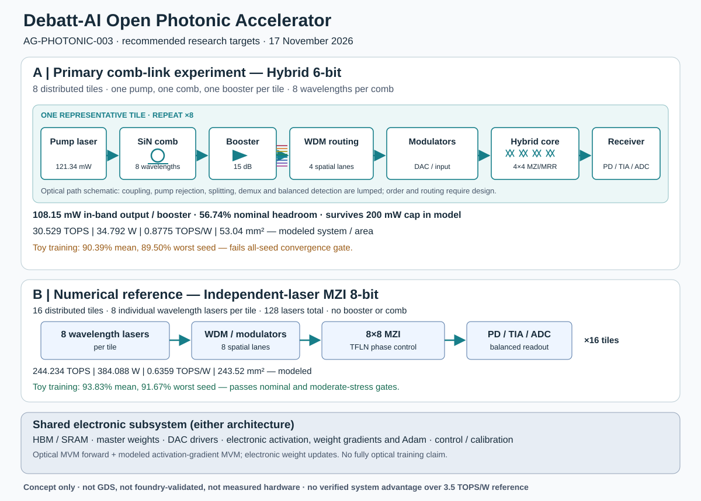

# AG-PHOTONIC-003 — final research report

**17 November 2026 | Debatt-AI Open Photonic Lab | Version 1.0**

**Scope:** independent replay, analytical corrections and conditional numerical
training of photonic AI accelerator candidates. No fabricated or measured chip,
foundry-ready layout, calibrated transfer model or demonstrated hardware speedup.

## Executive conclusion

The original AG003 structured results were reproduced. Subsequent controlled
corrections increased analytical feasibility from 325 to 2,758 of the same
330,960 configuration keys (8.49×), including 152 six-bit comb-powered
configurations, but no eight-bit comb configuration. The new paired training
study did not establish reliable six-bit convergence; the selected passive
eight-bit independent-laser MZI proxy passed the preregistered nominal and
moderate-stress gates. No nominal candidate exceeds the assumed electronic
system reference of 3.5 TOPS/W. This is a negative result for a production
architecture, not a negative result for continued component research.

Recommend a **two-track research program**: a smaller six-bit comb-powered
Hybrid with substantial modeled booster headroom as the optical experiment,
and the eight-bit independent-laser MZI as the numerical precision reference.
Neither is a validated production OPA. The highest-efficiency six-bit comb
candidate is retained as a separate optimization target.

*Figure 1. Conceptual system blocks and representative repeated tiles, not a
GDS layout or verified optical routing. [Standalone SVG](architecture-recommendation.svg).*

## 1. Provenance and reproducibility

The seven original source/report files (164,850 bytes) were recovered from
the existing Antigravity environment through a direct Files API GET, not a
new model interaction. Recovery run [44074735184](https://github.com/cryptomanxxx/debatt-ai-open-photonic-lab/actions/runs/44074735184).
The snapshot is not proof of historical immutability. The credential-free
isolated replay [44090316677](https://github.com/cryptomanxxx/debatt-ai-open-photonic-lab/actions/runs/44090316677)
matched 1,882 structured values exactly, 26 numerically within tolerance,
and ignored two runtime fields; no differences outside that policy.
The source dependency versions matched (Python 3.12.3, NumPy 2.5.4,
Pandas 3.1.1); the container image tag was not digest-pinned.
See [recovery and replay documentation](README.md), [source audit](PRELIMINARY_AUDIT.md)
and [unaltered original report](original/report.json).

Each correction preserves earlier stages and the original. The result files
below are permanent Git evidence, with provenance manifests and environment
metadata; archived file checks are distinct from scientific validation.
The six experiments report 61 implementation checks in total (11+8+9+10+10+13),
all passing. These are not 61 independent physical experiments.

| Experiment | Purpose | Evidence |
|---|---|---|
| SYS001 | Independent energy/loss accounting | [result](../../../results/opa-sys-001/result.json) · [run 44103015958](https://github.com/cryptomanxxx/debatt-ai-open-photonic-lab/actions/runs/44103015958) |
| SYS002 | Correct duplicate pump fanout | [result](../../../results/opa-sys-002/result.json) · [run 44106677587](https://github.com/cryptomanxxx/debatt-ai-open-photonic-lab/actions/runs/44106677587) |
| SYS003 | Independent receiver / gain audit | [result](../../../results/opa-sys-003/result.json) · [run 44110377779](https://github.com/cryptomanxxx/debatt-ai-open-photonic-lab/actions/runs/44110377779) |
| SYS004 | Paired receiver and laser-limit corrections | [result](../../../results/opa-sys-004/result.json) · [run 44113634095](https://github.com/cryptomanxxx/debatt-ai-open-photonic-lab/actions/runs/44113634095) |
| SYS005 | Explicit booster accounting and gain selection | [result](../../../results/opa-sys-005/result.json) · [run 44118436433](https://github.com/cryptomanxxx/debatt-ai-open-photonic-lab/actions/runs/44118436433) |
| SYS006 | Paired numerical training and derating | [result](../../../results/opa-sys-006/result.json) · [run 44125011406](https://github.com/cryptomanxxx/debatt-ai-open-photonic-lab/actions/runs/44125011406) |

## 2. Original findings and audit

Original analytical population: 330,960 keys, 325 feasible before training.
Best reported convergent candidate CFG-0100: six-bit independent lasers,
488.467 sustained TOPS, 317.085 W, 1.5405 system TOPS/W; no convergent
comb candidate in the selected original ranking pool. Original mean toy
validation accuracy: digital (actually FP64 weights) 94.50%, 8-bit
93.05%, 6-bit 91.50%, 4-bit 79.72%.

The original narrative's 1.73 and 1.3 TOPS/W values contradict structured
results and must not be used. Its loss check could pass without a nominal
loss value; its convergence ranking assumed untested 12-bit convergence
and considered only a subset of feasible keys. Its training noise did not
come from the simulated wavelength transfer matrices. The original ideal
SVD/MZI test had relative error 2.32e-15, but its nonideal 16-channel
nominal 8-bit circuit case achieved only 3.23 effective MAC bits. This
is a separate illustrative circuit result, not validation of the SYS006
eight-bit training proxy.

## 3. Corrected optical and system models

### SYS001 — system boundary and energy

The independent fixed-configuration calculation gives 28.0309 dB nominal
versus 18.6309 dB low loss (9.4 dB reduction). It does not assert nominal
feasibility. Reconstructed CFG-0100 yields 488.467 TOPS and 317.084 W
system proxy, 1.5405 TOPS/W; chip-only 81.930 W, card proxy 275.725 W.
At 3.5 TOPS/W the same throughput requires at most 139.562 W.

The largest terms are HBM 122.117 W, lasers 71.678 W, cooling proxy
41.359 W, converters/drivers 40.706 W and electronic compute 26.331 W.
The assumed overlapped step is 19.784 microseconds versus 35.890
microseconds serial. Timing overlap is not verified scheduling.
Six of 45 sensitivity cases exceed the assumed electronic reference, all
with HBM power multiplier 0.25 (outside the original range); these are
hypothetical sensitivity points, not nominal candidates. Laser WPE 50%
also exceeds the original assumed range.

### SYS002 — pump fanout

The original splitter loss already contains the ideal branch-count loss.
Remove the duplicate combs-per-pump factor from the pump-power and
threshold expressions. The paired sweep increases feasibility 325 to
472: 147 added, none removed. Best nominal efficiencies do not change.

### SYS003 — receiver and amplifier audit

Independent bisection solves the retained signal-current noise model.
With 10 GHz modulation, 7 GHz receiver noise bandwidth, 50 GHz optical
bandwidth and 20 dB CMRR, nominal target SNR is 29.35/41.39/53.43/77.51
dB at 4/6/8/12 bits. RIN-limited ceiling is 66.55 dB under these assumptions.
Receiver signal powers (mW):

| Bits | No ASE | 1 µW receiver ASE | 10 µW receiver ASE |
|---:|---:|---:|---:|
| 4 | 0.04201 | 0.48808 | 4.82748 |
| 6 | 0.18201 | 7.77409 | 77.39685 |
| 8 | 1.01906 | 130.26885 | 1297.45970 |
| 12 | no root | no root | no root |

The 432 receiver, 288 simplified link and 12 ideal coherent-control
cases are diagnostics, not system configurations. Six of 64 six-bit
comb link cases pass; zero of 64 eight-bit comb cases pass. The separate
ideal coherent receiver calculation is not a calibrated replacement for
the retained current model: LO distribution, ASE, phase tracking,
imbalance and receiver saturation remain unresolved.

### SYS004 — paired corrections

Replace the hardcoded signal–ASE bandwidth ratio with explicit receiver
to optical bandwidth; remove the arbitrary positive RIN margin while
retaining the physical ceiling. Compare aggregate independent-laser
bank launch against the per-laser limit times wavelength count, while
retaining full bank power in electrical accounting.
Baseline 472; receiver only 517; laser only 841; combined 886.
The 414 additional feasible keys include 82 eight-bit independent-laser
keys; still no six-bit comb.

### SYS005 — explicit gain and power planes

Separate comb upstream rolloff/rejection from downstream loss. Track
per-line signal and ASE at booster input/output and receiver, total
in-band output per booster, source count, optical launch and source/
amplifier electrical costs. Retain the 250 mW in-band cap and 6 dB NF
assumptions; no real gain compression curve or out-of-band spectrum.
Search passive and integer gains 1–25 dB, selecting minimum source plus
booster electrical cost among admissible solutions. Compare corrected
fixed maximum gain and optimized gain on identical keys.

| Model stage | Total feasible | Six-bit comb | Eight-bit independent |
|---|---:|---:|---:|
| Original | 325 | 0 | 0 |
| SYS002 | 472 | 0 | 0 |
| SYS004 combined | 886 | 0 | 82 |
| SYS005 corrected fixed max | 2,389 | 0 | 82 |
| SYS005 optimized | 2,758 | 152 | 82 |

The corrected accounting adds 1,503 keys at fixed maximum gain;
optimization adds another 369. All legacy feasible keys remain.
The 152 six-bit comb cases use 14–19 dB gain; none uses 25 dB.
5,147 corrected feasible records were checked independently (not unique
keys). No eight-bit comb or 12-bit candidate passes.

| Optimized architecture | 4-bit | 6-bit | 8-bit |
|---|---:|---:|---:|
| MZI comb | 554 | 51 | 0 |
| MRR comb | 853 | 37 | 0 |
| Hybrid comb | 702 | 64 | 0 |
| Independent laser MZI | 226 | 182 | 82 |
| SingleWave MZI | 7 | 0 | 0 |
| Total | 2,342 | 334 | 82 |

Best nominal system efficiency is 2.2481 TOPS/W (four-bit Hybrid),
not a converged training candidate. Best six-bit comb is 1.2428
TOPS/W (Hybrid, 8×8), but has only 1.53% modeled booster headroom.

## 4. SYS006 — numerical training

The preregistered paired study reuses the original synthetic teacher
data, with 8 inputs, 128 student hidden units and 6 output classes,
3,000 training and 600 validation examples, Adam, batch 64, learning
rate 0.008, 120 epochs and three seeds. Train 90 models in 30 cases,
with identical batch order/initialization streams; record 10,800 epochs
and 28 separate saturation derating cases. Digital FP32 and FP64
controls, quantization-only cases and original fixed noise controls
separate the effects. Target is final accuracy >=90% and at least one
five-consecutive-epoch target run, for every seed.

The nominal proxy maps independent receiver SNR to normalized RMS noise
sigma = 10^(-SNR_dB/20), adds that to quantized MVM outputs and quantizes
operands and output. ReLU, softmax, weight gradients and Adam remain
electronic; noisy activation-gradient MVM is a surrogate. This is not
a signed optical encoding or a calibrated architecture-specific error
model. All five six-bit representatives use the same proxy, so their
identical results do not independently validate five hardware designs.

| Case | Mean final accuracy | Worst seed | All-seed pass |
|---|---:|---:|---|
| Digital FP32 | 94.33% | 93.33% | yes |
| Digital FP64 | 94.11% | 93.17% | yes |
| 4-bit quantization only | 79.22% | 73.00% | no |
| 6-bit quantization only | 91.00% | 89.83% | no |
| 8-bit quantization only | 93.83% | 92.67% | yes |
| 4-bit nominal | 79.72% | 75.17% | no |
| 6-bit nominal | 90.39% | 89.50% | no |
| 8-bit nominal | 93.83% | 91.67% | yes |
| 6-bit moderate stress | 90.39% | 89.33% | no |
| 8-bit moderate stress | 93.39% | 91.67% | yes |
| 8-bit severe stress | 91.61% | 89.17% | no |

Moderate stress is 3× nominal RMS noise plus 1% RMS bias; severe stress
is 10× plus 5% bias. Four-bit quantization alone is a substantial
bottleneck. Six-bit nominal reaches the threshold temporarily in all
seeds, but seed 42 finishes below it. The nominal eight-bit proxy is
0.50 percentage points below digital FP32 in mean validation accuracy.
The six-bit original-noise control fails the new paired gate
(89.72% mean); this is not an exact replay of the original loop.
No 12-bit training result is inferred. No large-model or energy-to-target
extrapolation is made.

Digital weight deployment under nominal noise yields means 73.39%,
91.50%, 94.11% for 4/6/8 bits respectively; it can be a useful separate
deployment control, not proof of a general training strategy.

## 5. Recommended research architectures

No architecture is globally optimal across accuracy, optical margin and
system efficiency. The following selected representatives have distinct
roles; all figures are conditional model outputs.

| Property | A: Hybrid 6-bit headroom | B: independent MZI 8-bit | C: Hybrid 6-bit efficiency |
|---|---:|---:|---:|
| Distributed tiles | 8 | 16 | 8 |
| Mesh dimension | 4 | 8 | 8 |
| Wavelengths per tile | 8 | 8 | 8 |
| Pumps / independent lasers | 8 | 128 | 8 |
| Comb rings / boosters | 8 / 8 | 0 / 0 | 8 / 8 |
| MZI count | 48 | 1,024 | 224 |
| MRR weight rings | 256 | 0 | 512 |
| Phase shifters | 352 | 2,048 | 960 |
| Modulators / DACs / ADCs (each) | 256 | 1,024 | 512 |
| Photodiodes | 512 | 2,048 | 1,024 |
| Gain | 15 dB | 0 dB | 14 dB |
| Source launch per pump / per bank | 121.34 mW | 2,508.30 mW | 347.73 mW |
| In-band booster output per booster | 108.15 mW | n/a | 246.18 mW |
| Booster headroom | 56.74% | n/a | 1.53% |
| Total modeled path loss | 21.27 dB | 23.38 dB | 25.88 dB |
| Sustained system TOPS | 30.529 | 244.234 | 122.117 |
| System proxy W | 34.792 | 384.088 | 98.256 |
| System TOPS/W | 0.8775 | 0.6359 | 1.2428 |
| Chip-only TOPS/W | 3.6712 | 3.3796 | 5.9548 |
| Modeled area mm² | 53.04 | 243.52 | 120.05 |
| Nominal toy convergence | fail | pass | fail |

All three assume TFLN Pockels phase control. For B, the bank launch
means eight individual sources, about 313.54 mW each; no comb or booster.
Do not compare this bank value directly with a single pump limit.

**A — primary optical research target.** Best booster headroom among
the 152 six-bit comb keys. It survives the 200 mW derated cap in the
model without gain reselection. Begin with one representative tile,
measure transfer, source/booster operating points and wavelength errors;
do not fabricate the full eight-tile system from this schematic.

**B — precision reference.** The only selected architecture's numerical
proxy passing both nominal and moderate-stress training gates. Retain
as a comparison and source of precision targets. High modeled source
power and system cost prevent recommending it as a production OPA.
The passive source topology is not stressed by booster derating.

**C — efficiency optimization target.** Highest system TOPS/W among
six-bit comb keys. It fails at a 237.5 mW cap even after gain reoptimization;
avoid using nominal feasibility as evidence of operational robustness.

A is prioritized for experimental feasibility and margin, not because
its six-bit training proxy passes. B is a numerical reference, not proof
of hardware precision. C is a longer-term target, not a first test chip.
The six-bit independent-laser candidate (1.5405 TOPS/W) also fails the
new nominal convergence gate and is not an accepted alternative.

## 6. Remaining blockers and falsifiable follow-up

- **Precision:** measure or explicitly simulate signed, wavelength-resolved
  MVM transfer with the actual architecture; include phase/weight error,
  crosstalk, drift, converter range, clipping and calibration. Compare
  quantization-aware training on independent seeds and held-out tasks.
  Target >=90% on every preregistered seed without silently changing the
  gate; test larger tasks separately.
- **Gain and receiver:** validate actual gain/NF/compression and total ASE,
  launch power, receiver dynamic range, CMRR, LO requirements and
  power-plane accounting. Check margin under temperature and fabrication
  perturbations; the 200 mW cap test is only one modeled perturbation.
- **Eight-bit comb:** quantify required reductions in loss/noise or changes
  in encoding/receiver/source topology before claiming feasibility.
- **Hybrid mapping:** the MZI-plus-MRR compact model assumes useful
  matrix operations and WDM scheduling; prove implementable signed matrix
  mapping, independent weight programmability, and backward-pass routing.
  No foundry-compatible integrated SiN/TFLN/gain process is established.
- **System:** measure or model scheduling dependencies, memory traffic,
  converters, calibration, electronic compute, host overhead and cooling
  at matched workload and accuracy. The 3.5 TOPS/W reference is an
  assumption, not a measured GPU comparison. A chip-only efficiency
  cannot be compared directly to system efficiency. No demonstrated
  advantage, physical fabrication or LLM training claim.

Continue the existing [research roadmap](../../../PHOTONIC_RESEARCH_ROADMAP.md).
Prioritize bounded nonlinear activation and precision/transfer experiments,
then gain and materials integration; retain all other proposed tracks.
The completed AG003 audit is a reproducible starting point, not the
completion of the accelerator program.

## 7. Reproduction and evidence

From repository root use the locked circuit environment and experiment
registry, with OPENBLAS_NUM_THREADS=1 and OMP_NUM_THREADS=1:

| Experiment | Script under simulations/circuit |
|---|---|
| SYS001 | see [registry](../../../simulations/experiments.json) |
| SYS002 | ag003_pump_fanout_v002.py |
| SYS003 | ag003_receiver_audit_v003.py |
| SYS004 | ag003_receiver_sweep_v004.py |
| SYS005 | ag003_gain_sweep_v005.py |
| SYS006 | ag003_convergence_v006.py |

Run experiments in a disposable checkout: result scripts write into
results directories; do not overwrite the archived evidence on main.
See [convergence protocol and results](CONVERGENCE.md),
[stage3 gain model](stage3/README.md), and the archived provenance
files for exact run identities and file digests. The report and diagram
are a synthesis of existing evidence; no new simulation or hardware
measurement is claimed here.
