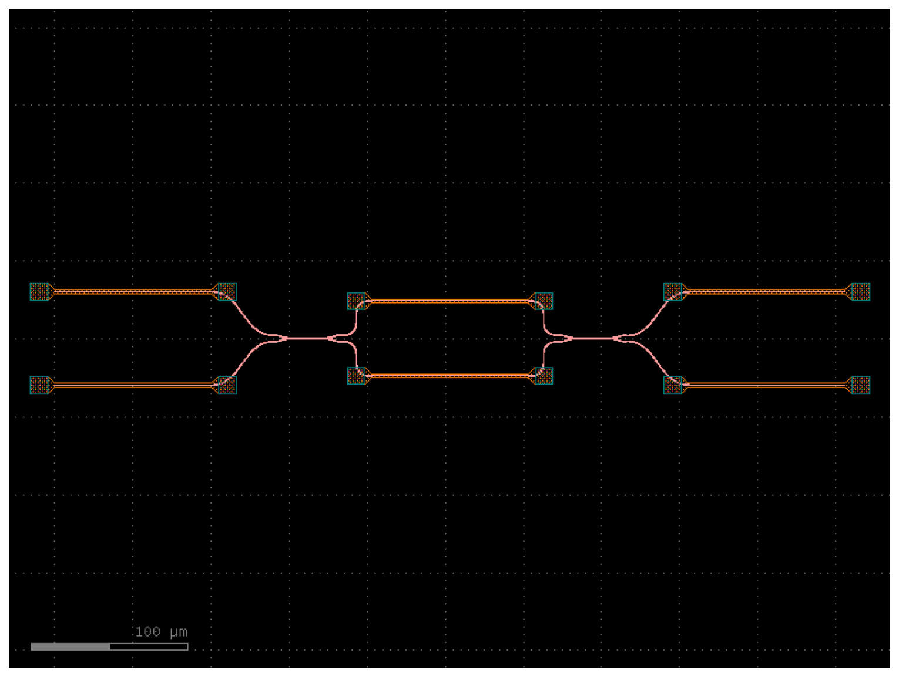

# Design catalog

Every chip layout in the lab, generated from the `design.json` datasheet that each layout script writes next to its GDS file. Do not edit this file by hand: run `python tools/build_catalog.py`. The same data is in [`designs.json`](designs.json) for search and filtering; the datasheet fields are described in [`SCHEMA.md`](SCHEMA.md).

1 design(s).

| Preview | Design | Function | PDK | λ (µm) | Footprint (µm) | Ports | Controls | Status | Checks |
|---------|--------|----------|-----|--------|----------------|-------|----------|--------|--------|
|  | **[OPA-LAYOUT-001](../results/opa-layout-001/)** Programmable 2x2 MZI with balanced dummy heaters | programmable 2x2 MZI (any 2x2 unitary with phi, theta, a, b) | gdsfactory generic PDK | 1.55 (1.54–1.56) | 537.8 × 71 | 2 in / 2 out | 4 heaters, 2 dummy heaters | exploratory | 10/10 |

## Key results

### OPA-LAYOUT-001: Programmable 2x2 MZI with balanced dummy heaters

Tags: `mzi`, `2x2`, `phase-shifter`, `directional-coupler`, `generic-pdk`, `silicon`, `programmable`

- **Coupler:** 236 nm gap, 23 um straight section, 50:50 at 1.55 um (OPA-COUPLER-002)
- **Coupling length:** 52.0 um (MPB); 3D FDTD agrees within 0.4 % (OPA-COUPLER-001/002)
- **Band within 5 % of 50:50:** 1.54-1.56 um (OPA-COUPLER-003)
- **Etch bias +-10 nm:** split 49.9%-50.2% (OPA-COUPLER-003)
- **Programmability:** any 2x2 unitary, error < 1e-14 (ideal model) (OPA-MZI-001)

Limitations: generic example PDK, not a foundry process; no DRC; no fiber couplers or bond pads; narrowband couplers
