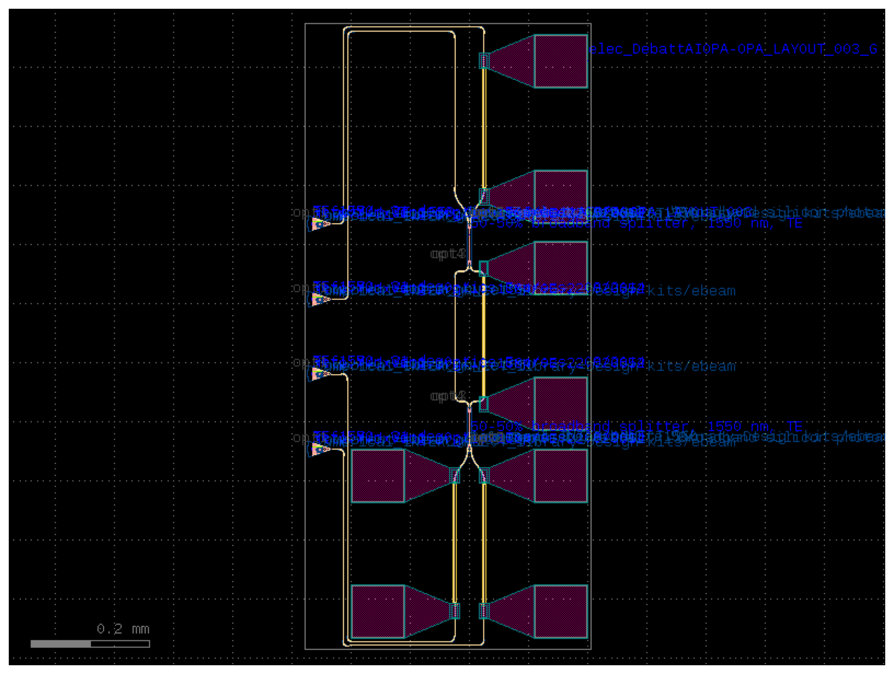

# OPA-LAYOUT-003, version 1

Fully programmable 2×2 MZI (θ, φ, a, b) in the open SiEPIC EBeam PDK
(ubcpdk 3.3.0): two broadband couplers, four 200 µm TiN heaters, four TE
grating couplers at 127 µm pitch and eight bond pads, on 484 × 1058 µm
(floorplan included).



- `mzi_2x2_siepic_full.gds`: the layout, exactly as released
- `design.json`: its datasheet (see [`catalog/SCHEMA.md`](../../catalog/SCHEMA.md))
- `mzi_2x2_siepic_full.png`: preview
- `LICENSE-ubcpdk.txt`: the MIT licence of the PDK whose cells it contains

**Status: `drc-clean`.** 0 violations of the PDK's own DRC deck, and all 11
layout checks pass, including electrical isolation of the eight pads. Not
checked: SiEPIC functional verification, thermal crosstalk, the broadband
coupler, and any foundry review. See
[`provenance.json`](provenance.json) for the generating commit and checksums.

To regenerate and compare (Python 3.12, Ubuntu 24.04):

```bash
git checkout d002fa1dcfedc844108644a04152cd3f2dc27ebe
pip install -r layout/requirements-lock-ubc.txt
sudo apt-get install klayout=0.28.16-0ubuntu0.24.04.1
python layout/mzi_2x2_ubc_v003.py
sha256sum results/opa-layout-003/mzi_2x2_siepic_full.gds   # 655636cb...
```
